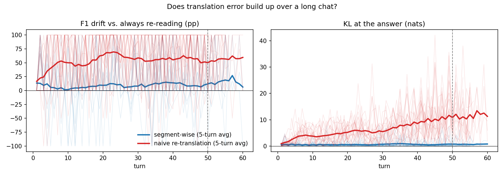

# kill-test

**Question:** when two models take turns in a long chat and pass translated notes (KV caches) to each other, does the translation error build up over time, and differently for different chats? If not, a "smart refresh" has nothing to fix.

## What the numbers mean

### The cast
| Term | Meaning |
|---|---|
| **S / L** | **S**mall model (Qwen3-0.6B) and **L**arge model (Qwen3-1.7B). "0.6B" = 0.6 billion adjustable numbers inside the model |
| **KV cache** | The model's "notes" on everything said so far |
| **Prefill** | Re-reading the whole chat to make fresh notes. Accurate but expensive |
| **Translator (mapper)** | Math that converts one model's notes into the other's shorthand ([Heo et al.](https://arxiv.org/abs/2608.03893)) |
| **Turn** | One question + one answer. A **chat** (session) is ~60 turns |
| **CoQA** | Public dataset of stories, each with a chain of questions and true answers |

### The three versions
| Name | What happens at each handoff |
|---|---|
| **prefill** | The answering model re-reads everything itself. Gold standard |
| **sw** (segment-wise) | Each model keeps its own notes. Each new page is translated **once**, from the notes of the model that read it |
| **nv** (naive) | One shared set of notes, **fully re-translated** at every handoff, including pages that were already translations (a photocopy of a photocopy) |

### The scores
| Term | Meaning |
|---|---|
| **F1** | How right an answer is: word overlap with the true answer, 0 to 1. It combines *precision* (of the words said, how many were right) and *recall* (of the right words, how many were said). True *"Mark Twain"* vs. said *"The writer is Mark Twain"* → precision 2/4, recall 2/2 → F1 = 0.67 |
| **pp** | Percentage points: plain subtraction of percentages (70% vs. 60% = 10 pp) |
| **Drift** | prefill's F1 − the other version's F1, in pp. **Positive = worse than re-reading** |
| **KL** (KL divergence) | How differently the model is "thinking" right before it answers: compares its probabilities for every possible next word with prefill's. 0 = identical, ~0.1 = nearly the same, ~1 = noticeably different, ~10 = wildly different. Unit: nats. Less noisy than F1 |
| **Surprise** | How unexpected the new question's words were to the model (average −log probability). Our proposed warning sign |

### The statistics
| Term | Meaning |
|---|---|
| **95% CI** | Range that very likely holds the true average, given only 20 chats. **If it includes 0, "no effect" can't be ruled out.** Computed by bootstrapping (resampling the chats thousands of times) |
| **p** (permutation test) | For "do chats differ?": the chance of differences this big if all chats were really the same. Below 0.05 = they really differ |
| **Spearman ρ** | Does one thing rise when another rises? −1 to +1, 0 = no relationship. Our bar for "the warning sign works" was 0.3 |
| **Oracle version** | The signal computed with information you wouldn't have in real use (prefill's own surprise): the best it could do |
| **Paired growth** | Each chat's late drift minus its *own* early drift, so harder chats don't skew the result |

## The experiment

1. **Two models from the same family** whose notes have the same shape: Qwen3-0.6B and Qwen3-1.7B (one 12 GB GPU).
2. **Built the translator:** both models read 64 web texts (FineWeb-Edu), and we learned a linear "dictionary" from one model's notes to the other's, in both directions.
3. **Built 20 long chats:** 4 CoQA stories glued together, up to 15 questions each, giving 48–60 turns.
4. **The models alternate answering**, large model first.
5. **Every chat was played 3 ways side by side:** prefill, segment-wise, naive.
6. **Same history for all three:** after each turn the *true* answer goes into the chat (teacher forcing), so the only difference between versions is the notes.
7. **Measured every turn:** F1, KL vs. prefill, and surprise.
8. **Decision rules were written down before running** (`thresholds.json`), so the test was fair.

## The graph

From `results.jsonl` (20 chats), saved in `analysis/`. Blue = segment-wise, red = naive.

### Does error build up over a long chat? (`fig1_drift_vs_turn.png`)



- **x-axis:** turn (1–60). **Faint lines:** individual chats. **Bold lines:** average over the 20 chats (5-turn smoothing). **Dashed grey line:** turn 50, where "late" starts.
- **Left, F1 drift** (points worse than always re-reading): single chats swing between −100 and +100 because one answer is often fully right or fully wrong, so read the bold lines. Red climbs from ~15 to ~50–60 by turn 20, then levels off; blue stays around 5–15.
- **Right, KL** (how differently the model thinks than when it re-reads): red climbs steadily from ~1 to ~12; blue stays flat near 0.5.
- Red levels off on the left but not on the right because F1 has a ceiling: once answers are mostly wrong they can't get much worse, while KL keeps measuring the notes getting blurrier.
- **Reading:** naive re-translation piles up errors; segment-wise pays a small fixed cost and doesn't build up. The right panel is the clearest picture of the result.

## How to run

```bash
pip install -r requirements.txt
python -m pytest -q                                  # ~10 s on CPU, checks the plumbing with tiny random models

# 0. Agree on thresholds.json FIRST (what counts as drop / pivot / go). Don't change it after.
python scripts/fit_mapper.py    --pair 4b-8b         # 1. fit translators: small->large and large->small
python scripts/check_handoff.py --run runs/4b-8b     # 2. sanity check: does ONE handoff work?
python scripts/run_kill_test.py --run runs/4b-8b     # 3. 20 chats x ~60 turns x 3 versions
python scripts/analyze.py       --run runs/4b-8b     # 4. plots + DROP / PIVOT / GO
```

Step 3 can be stopped and restarted; finished chats are skipped.

### Which model pair for your GPU

All pairs below are "matched-KV" (8 KV heads, head size 128), which the mapper needs. Same tokenizer, so pages line up token for token.

| `--pair` | Models | Rough GPU memory |
|---|---|---|
| `0.6b-1.7b` | Qwen3-0.6B ↔ 1.7B | ~12–16 GB, or 4–8 GB with the large model on the CPU (below) |
| `1.7b-4b` | Qwen3-1.7B ↔ 4B | ~24 GB (add `--mapper-dtype bfloat16` to steps 2–3 if tight) |
| `4b-8b` (default) | Qwen3-4B ↔ 8B | ~40 GB |
| `8b-32b` | Qwen3-8B ↔ 32B (a pair Heo et al. tested) | 80 GB+, or two GPUs: `--devices cuda:0,cuda:1` |

Out of memory while fitting? Use `--group-size 2` (or 1). These numbers are estimates: about 2 bytes per model parameter, plus the translators and fitting buffers.

### Small GPU (under ~8 GB): small model on the GPU, large model on the CPU

Results are the same; only speed changes. The 1.7B model on the CPU makes its turns slow, so expect hours (an overnight run).

```bash
python scripts/fit_mapper.py    --pair 0.6b-1.7b --devices cuda,cpu --group-size 1
python scripts/check_handoff.py --run runs/0.6b-1.7b --mapper-dtype bfloat16 --mapper-device cuda
python scripts/run_kill_test.py --run runs/0.6b-1.7b --mapper-dtype bfloat16 --mapper-device cuda
python scripts/analyze.py       --run runs/0.6b-1.7b
```

- Fitting runs each model over the calibration texts **once** and keeps their notes on disk while it works:
  about 15 GB for `0.6b-1.7b` with the default 64 texts, plus ~3.8 GB for the two saved translators.
- `--devices` is remembered in `run_config.json`, so steps 2–3 reuse it.
- Try `run_kill_test.py --n-sessions 2` first: it prints seconds per chat, so you can estimate the full run.
- The 1.7B model needs about 7 GB of normal RAM on the CPU (it runs in float32 there).

### Out of disk space / `basic_ios::clear: iostream error` when saving

School home folders usually have a storage quota (check `quota -s`). Put the big files on the machine's local disk:
`--cache-dir /tmp/$USER-cache --out /tmp/$USER-run`, then pass `--run /tmp/$USER-run` to the later steps.
Copy `results.jsonl` and `analysis/` back home at the end, because `/tmp` can be wiped. Or use fewer texts with `--n-calib 32`.

### pytest crashes with `substitute_in_graph expects a function ... ansible`

Another pytest add-on on that computer (Ansible's) breaks PyTorch. Our tests need no add-ons, so turn them off:
`PYTEST_DISABLE_PLUGIN_AUTOLOAD=1 python -m pytest -q`

### GPU nodes without internet (common on university clusters)

On a machine with internet:
```bash
python scripts/download_data.py --out data/
huggingface-cli download Qwen/Qwen3-4B && huggingface-cli download Qwen/Qwen3-8B
```
Then add `--calib-text-file data/calib.txt` to step 1 and `--coqa-file data/coqa_validation.json` to steps 2–3.
